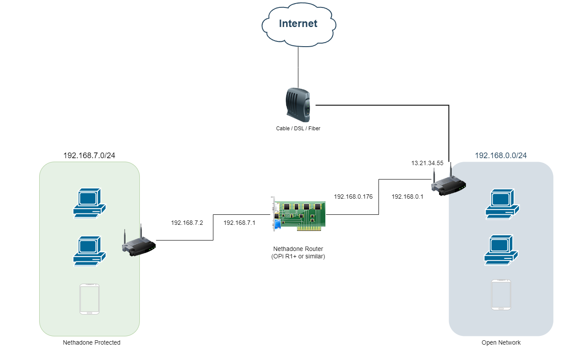
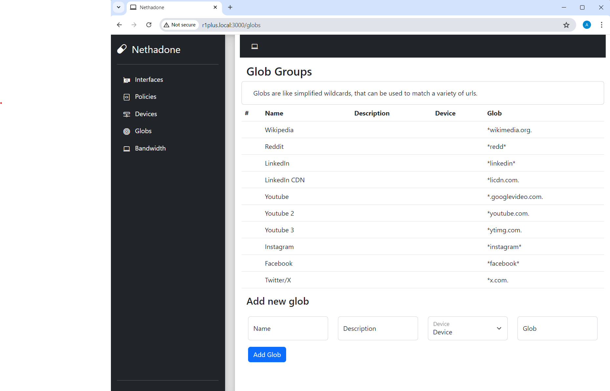
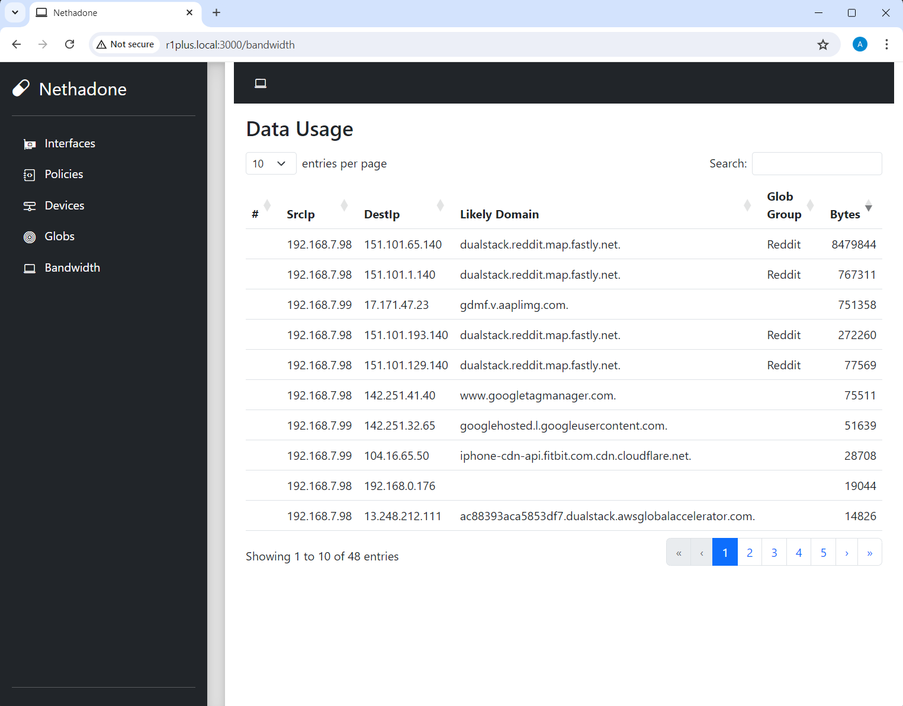

# Installation

Getting nethadone onto a board takes four steps:

1. Flash Armbian and install a BTF-enabled kernel.
2. Run `scripts/install.sh`, which installs the packages, binary, config and service.
3. Choose a network topology (wifi hotspot or wired).
4. Check the result with `sudo nethadone check`.

## Supported boards

| Board | Arch | Kernel | BTF kernel source | Status |
|---|---|---|---|---|
| Orange Pi R1 / Zero | armv7 | Armbian `legacy` sunxi 6.1 | `btf-kernel` release (`kernel-legacy-sunxi-orangepi-r1.tar.gz`) | tested |
| Orange Pi R1 Plus | arm64 | Armbian `legacy` rockchip64 | not currently published; build with the `armbian-btf-kernel-build` workflow | worked previously |
| x86_64 VM | amd64 | distribution kernel | most already have BTF | for testing |

Tested with the Ubuntu Noble based Armbian images (24.04 / 24.08), available
from the [Armbian download page](https://www.armbian.com/download/?tx_maker=xunlong).

## 1. Image and kernel

`scripts/customize-image.sh` installs the BTF kernel for the board, then runs
`install.sh --no-start`, which installs the files without touching the network. You can run it:

* **on the flashed board**: `sudo scripts/customize-image.sh`, then reboot into the new kernel; or
* **on the image before flashing**, via the chroot wrapper (it uses `sudo` a lot, so a VM is a good place for it):

  ```bash
  cd scripts
  ./build.sh -i /tmp/Armbian_community_24.8.0-trunk.554_Orangepizero_noble_current_6.6.43.img -m ~/mnt -a arm
  ```

  `-i` is the uncompressed image, `-m` an empty folder to mount it on, and
  `-a` is `arm` (R1/Zero) or `aarch64` (R1 Plus).

## 2. Install nethadone

On the booted board:

```bash
git clone https://github.com/atomic77/nethadone && cd nethadone
sudo scripts/install.sh            # plus the topology options below
```

or without a checkout:

```bash
curl -fsSL https://raw.githubusercontent.com/atomic77/nethadone/main/scripts/install.sh | sudo bash -s -- [options]
```

The script is safe to re-run, for example to upgrade to the latest release. It:

* installs `clang`, `libbpf-dev` and `libc6-dev` (the throttler is compiled on the device) and `avahi-daemon`;
* downloads the latest release binary to `/usr/local/bin/nethadone` (`--binary PATH` installs a local build instead);
* enables IPv4 forwarding (`/etc/sysctl.d/20-nethadone.conf`);
* writes `/etc/nethadone/nethadone.yml` with the detected LAN interface (an existing file is kept);
* installs and enables `nethadone.service` (databases go in `/var/lib/nethadone`);
* runs `nethadone check`, and starts the service only if every check passes.

## 3. Network topology

Nethadone routes between a **WAN** interface (towards your internet router)
and a **LAN** interface (where your devices are). The WAN is detected as the
interface with the default route; leave `wan_interface` empty to keep it that way.

### Wifi hotspot (simplest; Orange Pi Zero / R1)

```bash
sudo scripts/install.sh --hotspot nethadone 'a-good-password'
```

This creates a NetworkManager hotspot on the wifi interface (DHCP on
`10.42.0.0/24`, NAT out of the wired port), sets it as the LAN and makes it
start on boot. Plug the wired port into your main router.

> [!NOTE]
> The hotspot also runs a caching DNS server (`dnsmasq`). Clients that are
> given a local DNS server over DHCP usually skip DNS-over-HTTPS, so nethadone
> can see their lookups.

### Wired (R1 Plus, or any board with two ethernet ports)

```bash
sudo scripts/install.sh --lan lan0 --nat
```

`--nat` writes an nftables masquerade rule for the WAN to
`/etc/nethadone/nat.nft`, and the service re-applies it on every start. The LAN
interface also needs an address and a DHCP server for your devices, which
nethadone does not provide yet; one option is a secondary access point behind
the board:



Putting the board inline between your router and everything else covers
every device, but takes the network down if nethadone fails. While the
project is in development, a secondary network is the safer choice.

### Adjusting the configuration

`/etc/nethadone/nethadone.yml` holds only the settings that differ from the
defaults. All options are documented in the sample [config](../config/nethadone.yml).
Unknown keys are rejected, so typos fail loudly. After editing:

```bash
sudo nethadone check && sudo systemctl restart nethadone
```

## 4. Check

`nethadone check` verifies everything nethadone needs and changes nothing:

```text
$ sudo nethadone check
[ OK ] running as root
[ OK ] kernel 6.1.104 has BTF
[ OK ] kernel has HTB, netem, prio, clsact and cls_bpf (from /proc/config.gz)
[ OK ] throttler compiles with clang and passes the verifier
[ OK ] WAN interface eth0 is up
[ OK ] default route via WAN eth0
[ OK ] LAN interface wlan0 is up
[ OK ] IPv4 forwarding enabled
[ OK ] NAT masquerade rule present
```

The same checks run every time the service starts, so a broken setup fails
with a readable message in `journalctl -u nethadone` instead of a compiler error.

| Failure | Fix |
|---|---|
| `kernel ... has no BTF` | Install the BTF kernel (step 1) and reboot into it. |
| `kernel lacks CONFIG_NET_SCH_...` | The kernel is missing a qdisc nethadone uses; use a kernel with it enabled. |
| `clang not found` / `throttler test compile/load failed` | `sudo apt-get install clang libbpf-dev libc6-dev`. On armv7, also `libc6-dev-armel-cross`. The message includes the clang output. |
| `LAN/WAN interface X does not exist` | The fix line lists the interfaces that exist. Set `lan_interface`/`wan_interface`. |
| `LAN X has no IPv4 address` | The LAN needs an address and DHCP server: use the hotspot, or configure them for the wired port. |
| `IPv4 forwarding disabled` | Re-run `install.sh`, or apply `/etc/sysctl.d/20-nethadone.conf`. |
| `[WARN] no NAT masquerade rule found` | Only a warning: hotspots do their own NAT. For wired setups use `--nat`. |

## Runtime logs

When everything works, the journal shows the metrics and policy loops running:

```bash
$ journalctl -u nethadone --follow
...
2024/07/20 15:48:58 Setting up SimpleLoadAverage policy
2024/07/20 15:48:58 Setting up metrics collector
2024/07/20 15:51:41 Tick happened, collected  6  pairs
2024/07/20 15:51:56 Tick happened, collected  22  pairs
2024/07/20 15:52:25 Checking policy
2024/07/20 15:52:25 Found  0  globs for throttling
2024/07/20 15:52:25 0  globs that can be decreased
```

You can inspect the qdisc and class configuration with:

```bash
$ sudo tc -s class show dev lan0
class htb 1:10 parent 1:1 leaf 10: prio 0 rate 95Mbit ceil 95Mbit burst 1579b cburst 1579b
 Sent 0 bytes 0 pkt (dropped 0, overlimits 0 requeues 0)
 backlog 0b 0p requeues 0
 lended: 0 borrowed: 0 giants: 0
 tokens: 2093 ctokens: 2093

class htb 1:1 root rate 100Mbit ceil 100Mbit burst 1600b cburst 1600b
 Sent 0 bytes 0 pkt (dropped 0, overlimits 0 requeues 0)
 backlog 0b 0p requeues 0
 lended: 0 borrowed: 0 giants: 0
 tokens: 2000 ctokens: 2000

...

class htb 1:60 parent 1:1 leaf 60: prio 0 rate 50Kbit ceil 50Kbit burst 1600b cburst 1600b
 Sent 0 bytes 0 pkt (dropped 0, overlimits 0 requeues 0)
 backlog 0b 0p requeues 0
 lended: 0 borrowed: 0 giants: 0
 tokens: 4000000 ctokens: 4000000

$ sudo tc -s qdisc show dev lan0
qdisc htb 1: root refcnt 2 r2q 10 default 0x10 direct_packets_stat 3568 direct_qlen 1000
 Sent 11025865 bytes 8567 pkt (dropped 0, overlimits 0 requeues 1)
 backlog 0b 0p requeues 1
qdisc netem 30: parent 1:30 limit 1000 delay 20ms  2ms
 Sent 0 bytes 0 pkt (dropped 0, overlimits 0 requeues 0)
 backlog 0b 0p requeues 0
...
qdisc clsact ffff: parent ffff:fff1
 Sent 11025865 bytes 8567 pkt (dropped 0, overlimits 0 requeues 0)
 backlog 0b 0p requeues 0

```

There is a basic admin interface where you can configure glob
groups, see the currently active policy and inspect currently
mapped DNS to IP addresses, it will be running at:

http://orangepi-r1.local:3000/

mDNS is configured by default - if this address does not resolve
on your network, use the board's IP address instead.

Example glob group configuration:



If DNS packet inspection is working, you should see IP addresses
mapped to likely domains on the bandwidth page:



Policy decisions no longer need a Prometheus server. The raw counters
are still exported on `http://<router>:3000/metrics` if you want to
scrape and graph them yourself.

## Other boards

Armbian does not ship with BTF-enabled kernels out of the box at this
time; the two kernel builds available for Armbian `BOARDFAMILY` 
[`rockchip64`](https://github.com/armbian/build/blob/752ba047b3cb600095f981cbabb8be53d12bb9a2/config/boards/orangepi-r1plus.csc#L3) 
and [`sunxi`](https://github.com/armbian/build/blob/752ba047b3cb600095f981cbabb8be53d12bb9a2/config/boards/orangepi-r1.csc#L3), are targeted for the Orange Pi R1 Plus
and R1 and Zero respectively. Others with the same family are likely,
but not certain to work.

If you are interested in trying out another board and are having 
trouble getting a BTF kernel working, please raise an issue and I'll
try adding it to the Github Action.

### Porting to a new board

A board can run nethadone if `sudo nethadone check` passes. In practice that needs:

* a kernel with BTF (`/sys/kernel/btf/vmlinux`), and HTB, netem, prio, clsact (`NET_SCH_INGRESS`) and cls_bpf;
* `clang` able to compile the throttler for the BPF target with the distribution's UAPI headers;
* two interfaces, one towards the internet and one towards your devices.

Install the binary with `scripts/install.sh --binary ...` or let it download
the release for your architecture, then run the check.
